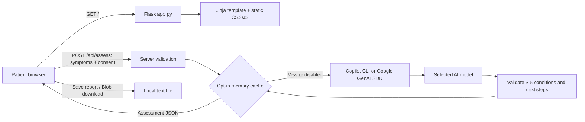

# HealthAI

A small Flask application for preliminary, AI-generated symptom education. Plain HTML, CSS, and JavaScript keep the interface build-free. **Not a medical device, diagnostic service, or substitute for a clinician.**

## Run locally

Requires Python 3.10+ and GitHub Copilot CLI (`copilot`) on `PATH` for the default provider. Copilot use needs an active Copilot subscription and a fine-grained personal access token with the **Copilot Requests** account permission. Set `AI_PROVIDER=gemini` to use Gemini instead.

```powershell
python -m venv .venv
.\.venv\Scripts\Activate.ps1
python -m pip install -r requirements.txt
New-Item -ItemType File .env
```

For Copilot, set `AI_PROVIDER=copilot` and `COPILOT_GITHUB_TOKEN=your-fine-grained-token` in `.env`. For Gemini, set `AI_PROVIDER=gemini` and `GEMINI_API_KEY=your-key`; optionally change `GEMINI_MODEL` (default: `gemini-flash-latest`). Never put credentials in browser code or commit them. The token previously tried in this workspace authenticated to GitHub but Copilot rejected it; check its Copilot Requests permission before using it here.

```powershell
python app.py
```

Visit http://127.0.0.1:5000. If the port is occupied, set `$env:PORT="5001"` before starting. Without provider credentials, the page still works and offers a **clearly labeled, fixed sample report**. Submitting to the live API without credentials returns a configuration error, never a fabricated AI result.

## Architecture



- `app.py`: application factory, routes, input validation, Copilot CLI and Gemini integrations, response validation, bounded cache, security headers, safe provider errors.
- `templates/index.html`: accessible symptom form, consent, urgent-care notice, empty/loading/result states.
- `static/app.js`: input validation, API calls, safe DOM rendering, fixed sample, local report download.
- `static/style.css`: responsive layout, focus states, reduced-motion support.
- `tests/test_app.py`: isolated API tests; provider calls are mocked and cost nothing.

### Request contract

`POST /api/assess`, `Content-Type: application/json`:

```json
{"symptoms": "Sore throat and runny nose for two days", "consent": true}
```

Success returns the submitted symptoms, `cached`, and `assessment` containing 3-5 `{name, explanation}` objects, `next_steps`, and `urgent`. The form displays the input alongside the result. Empty/whitespace/non-string input and inputs over 200 Unicode characters return 400; oversized request bodies return 413; missing provider configuration returns 503; provider failures or invalid model output return 502. The browser also validates, times out requests, and preserves the last report if a later request fails.

## Tests

```powershell
python -m pytest -q
```

Tests cover the 200-character boundary, invalid payloads, consent, missing configuration, provider failures, output shape, caching, expiry, and privacy headers. Live provider behavior requires a real key and is not covered by mock tests.

## Trade-offs

1. **Flask + vanilla JavaScript instead of a frontend framework:** one process and no Node build pipeline. Good for this focused flow, but more manual state management if the interface grows.
2. **JSON mode plus server-side validation instead of trusting model text:** rejects incomplete responses and enforces at least three conditions. It cannot establish medical correctness. No automatic retries keep cost and latency bounded; transient errors are visible and retryable.
3. **Privacy over caching by default:** `CACHE_ENABLED=false`. Opt in via `.env` for a per-process, 64-entry, five-minute cache keyed by normalized symptoms. Repeated requests bypass the model (tested through provider call counts, not a production latency benchmark). Expired entries are removed on the next valid request; process exit clears everything. This is not a distributed cache, and cached sensitive text remains in memory until eviction or cleanup.
4. **Local download instead of database history:** reports are generated in the browser, not written on the server. This avoids accounts and persistent health records, but users must protect and manage downloaded files themselves. No localStorage or cookies are used for health data.
5. **Prototype safety, not clinical triage:** the prompt requests uncertainty and urgent-care flags, while a permanent emergency notice remains visible. Model output can be inaccurate, biased, or miss an emergency. The application cannot diagnose or reliably rule out urgent conditions; it is not clinically validated.

## AI usage

- **GitHub Copilot:** When `AI_PROVIDER=copilot`, the application passes symptoms to the local Copilot CLI after consent and requests JSON. The CLI runs with shell, file, and URL tools denied; the server validates the response shape. Copilot requires a fine-grained PAT with the Copilot Requests permission and an active subscription. The sample report is fixed browser content and is not AI-generated.
- **Gemini API:** When `AI_PROVIDER=gemini`, the application sends symptoms to the configured Gemini model (default `gemini-flash-latest`) after consent and requests structured JSON. The server validates the response shape.

## Privacy and deployment limits

Symptoms are sent to the selected provider only after explicit consent and submission. For Copilot, the request goes through GitHub Copilot CLI and is subject to GitHub Copilot and selected model provider policies; for Gemini, it follows Google's API policies. This app does not guarantee provider-side deletion. Do not submit names or other identifying details. Application code does not log symptom bodies or persist assessments by default. External Google Fonts and Unsplash image requests disclose ordinary network metadata to those hosts, but not symptom content; self-host these assets for a stricter deployment.

The development server binds to loopback with debug disabled. Before public use: add authentication as appropriate, rate limiting and abuse controls, HTTPS, a production WSGI server, request-origin/CSRF defenses, operational monitoring without health-data logging, dependency locking, accessibility review, and a formal clinical/security/privacy review. No HIPAA or other regulatory compliance is claimed. Secrets belong in a managed secret store in production.

No repository commits are made automatically. Suggested commit sequence: `feat: add validated Flask symptom assessment API`, `feat: add responsive symptom form and local report downloads`, `test: cover assessment validation and caching`, `docs: document architecture and clinical limitations`.
